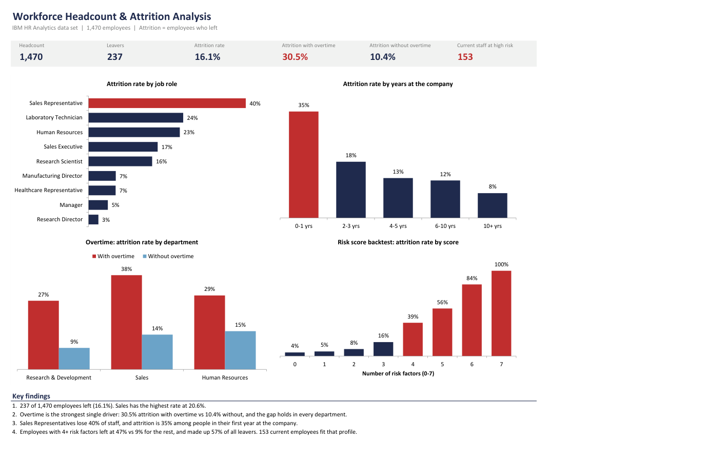
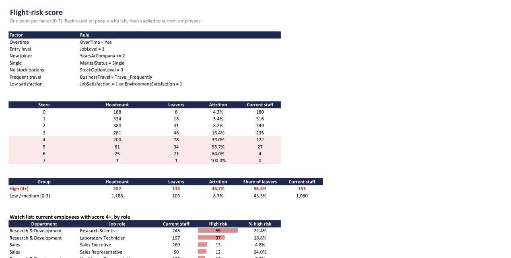
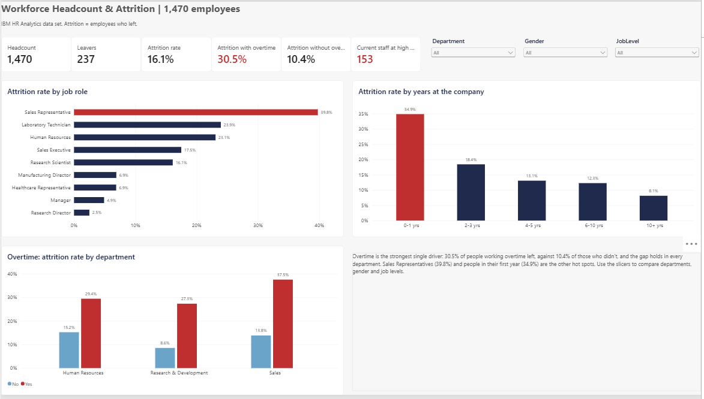

# Workforce Headcount & Attrition Analytics

Why do employees leave, and who is likely to leave next? This project answers that for a workforce of 1,470 people, using SQL for the analysis and Excel for the reporting, and ends with a simple flight-risk score that gives HR a watch list of current employees.



## Key findings

- **237 of 1,470 employees left (16.1%).** Sales had the highest rate (20.6%), then Human Resources (19.0%) and R&D (13.8%).
- **Overtime is the strongest single driver:** 30.5% attrition with overtime vs 10.4% without. The gap holds in every department; in Sales it's 37.5% vs 13.8%.
- **Sales Representatives lose 39.8% of staff**, more than twice the company rate. Laboratory Technicians are next at 23.9%.
- **The first year is the riskiest:** 34.9% attrition in years 0-1, falling to 8.1% after 10 years.
- Entry-level staff (job level 1), single employees, people with no stock options and frequent travellers each leave at roughly twice the rate of everyone else.
- **Flight-risk score:** employees with 4 or more of the 7 risk factors left at 46.7%, vs 8.7% for the rest, and made up 56.5% of all leavers. **153 current employees** fit that profile, most of them Research Scientists and Laboratory Technicians in R&D.

## Flight-risk score

Each employee gets one point for each factor below. Each one on its own makes leaving 1.8 to 2.9 times more likely.

| Factor | Attrition with | Without | Times more likely |
|---|---|---|---|
| Overtime | 30.5% | 10.4% | 2.9x |
| Job level 1 | 26.3% | 10.1% | 2.6x |
| No stock options | 24.4% | 9.9% | 2.5x |
| Tenure 2 years or less | 29.8% | 12.0% | 2.5x |
| Single | 25.5% | 11.7% | 2.2x |
| Lowest job or environment satisfaction | 22.7% | 12.5% | 1.8x |
| Travels frequently | 24.9% | 14.1% | 1.8x |

Attrition rises steadily with the score: from 4% at a score of 0, to 39% at 4, to 84% at 6.



I kept the score deliberately simple. A logistic regression or tree model would rank people a little better, but an HR business partner can't easily explain a model coefficient to a line manager. "This person works overtime, is in their first year and has no stock options" is something they can act on.

## Power BI version

`powerbi/HR_Attrition.pbip` is an interactive version for HR business partners, saved as a Power BI project so every visual and measure is reviewable as text.

- **Overview:** headline KPIs, attrition by job role, by tenure, and overtime by department, with slicers for department, gender and job level.
- **Drivers:** overtime, marital status, travel, stock options, income and age, each shown against the company rate in percentage points, plus survey scores.
- **Risk & watch list:** the score backtest, high vs low risk, and a filterable list of the 153 current employees with 4 or more risk factors.

Power Query drops the constant and unreliable columns and builds the bands and the risk score. Attrition rates and comparisons are DAX measures. Every number matches the SQL outputs and the Excel workbook.



To open it, double-click `HR_Attrition.pbip` in Power BI Desktop. Then go to **Home > Transform data > Edit parameters**, set **DataFolder** to the full path of this repo's `data` folder (ending in `\`), and click **Refresh**.

## How it's built

**SQL** (`sql/`, written for MySQL 8 and also run on SQLite)

| Script | What it does |
|---|---|
| `00_load_mysql.sql` | Creates the staging table and loads the CSV into MySQL |
| `01_schema.sql` | Splits the flat file into `departments`, `job_roles`, `employees` and `engagement_survey` |
| `02_data_checks.sql` | 12 checks: row counts, duplicate IDs, orphan keys, missing values, valid ranges, constant columns |
| `03_headcount.sql` | Headcount by department, role, job level and gender, with shares using window functions |
| `04_attrition_drivers.sql` | Attrition by department, role (ranked), overtime, tenure, age, income, travel, stock options and survey scores |
| `05_flight_risk.sql` | A view that flags each risk factor, the score backtest, and the watch list of current employees |

The queries use joins across the four tables, CTEs, CASE banding, and window functions (`RANK`, `ROW_NUMBER`, `SUM() OVER`). Results are saved in `outputs/`.

**Excel** (`HR_Attrition_Analysis.xlsx`)

| Sheet | What it does |
|---|---|
| Summary | Six KPIs, four charts and formula-driven key findings |
| Drivers | Attrition rate for 12 factors with COUNTIFS/SUMIFS, data bars, and red where the rate is above the company average |
| Risk | Score rules, backtest, high vs low risk, and the watch list by role |
| Pivots | Four pivot tables: role by department, tenure by overtime, job level and pay, and current staff by risk group |
| Data | The 1,470 records as an Excel table, with calculated columns for bands and the risk score |
| About | Data source, definitions and limitations |

## Data

[IBM HR Analytics Employee Attrition](https://github.com/IBM/employee-attrition-aif360) data set: 1,470 employees and 35 fields covering role, pay, tenure, travel, overtime and engagement survey scores. It is fictional data created by IBM data scientists and published under the Apache 2.0 licence (copy in `data/LICENSE-IBM-DATA.txt`).

Cleaning decisions:

- `EmployeeCount`, `StandardHours` and `Over18` have the same value for every employee, so they are dropped.
- `DailyRate`, `HourlyRate` and `MonthlyRate` have no relationship with `MonthlyIncome` (correlation close to 0), so `MonthlyIncome` is the only pay field used.
- All 12 data checks pass: no duplicates, no missing values, no orphan keys.

## How to run it

```
python scripts/run_sql.py
```

This loads the CSV into an in-memory SQLite database, runs scripts 01 to 05 and writes every result to `outputs/`. No installation is needed beyond Python 3.

To use MySQL instead, run from the project folder:

```
mysql --local-infile=1 -u root -p < sql/00_load_mysql.sql
mysql -u root -p hr_analytics < sql/01_schema.sql
```

then run 02 to 05 in the same way.

The Excel workbook needs no setup. Open it and start on the Summary sheet.

## Limitations

- The data is a snapshot with no leaving dates, so attrition rates are not annualised and trends over time can't be measured.
- The risk score is tested on the same data it was built from. On a real workforce it should be checked against the next 6 to 12 months of actual exits before anyone relies on it.
- Correlation is not cause. Overtime may be a symptom of under-staffed teams rather than the reason people leave, so the right action is to look at workload in those teams, not just to cap overtime.

## Repository layout

```
workforce-attrition-analytics/
├── HR_Attrition_Analysis.xlsx   Excel analysis
├── data/                        IBM data set and its licence
├── sql/                         MySQL scripts 00-05
├── scripts/run_sql.py           runs the SQL on SQLite and saves the results
├── outputs/                     query results as CSV
├── powerbi/                     Power BI project (.pbip) and theme
└── docs/                        screenshots used in this README
```

## Tools

SQL (MySQL 8 / SQLite: joins, CTEs, window functions, views), Power BI (Power Query, DAX), MS Excel (tables, COUNTIFS/SUMIFS, INDEX/MATCH, pivot tables, conditional formatting, charts), Python (csv, sqlite3).
